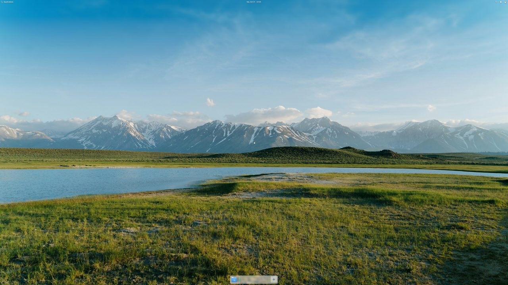
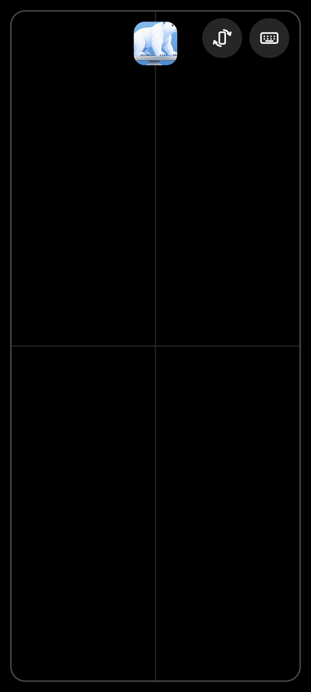

# elementary Mobile

elementary OS on your Android device, offline. Install the APK, tap the icon, and you get the
Pantheon desktop with Files, Terminal, Code, Web and System Settings. Nothing is downloaded:
the whole OS ships inside the APK.

This is a fork of [Local Desktop](https://github.com/localdesktop/localdesktop.github.io), which
installs Arch Linux with Xfce on first launch. elementary Mobile keeps Local Desktop's engine (a
Wayland compositor in the Android NDK plus proot) and replaces what runs on it.

**Note**: like Local Desktop, this expects a large enough display (a tablet, a foldable or DeX),
ideally with a keyboard and mouse. It brings a desktop to Android; it does not turn the desktop
into a phone UI.

Tap a text field and your phone's own keyboard comes up, with the desktop fitting above it. For
apps where it doesn't, open **On-screen keyboard** from the Applications menu.

On a phone, connect a monitor (USB-C to HDMI, a dock, or a wireless display): the desktop moves
to it and the phone becomes a trackpad, with buttons to turn the screen and to type with the
Android keyboard.

 

## How it works

1. The APK carries an elementary OS 8 root filesystem as a ~190 MB xz archive
   (`elementary-os-rootfs.tar.xz`, ~1 GB unpacked).
2. On first launch the app streams it straight out of the APK into its private storage, showing
   progress, then opens the desktop. No restart, no network.
3. proot runs the OS in a chroot-like environment, as the user `elementary`.
4. The app's built-in Wayland compositor shows one rootful Xwayland window, and Gala (elementary's
   window manager, which is X11-only when it cannot drive the display itself) runs the Pantheon
   Classic session inside it: Wingpanel, the Dock, notifications and the apps.

Rendering is done on the CPU (Mesa llvmpipe): Android's GPU drivers cannot be used from a glibc
userland. llvmpipe compiles shaders for the CPU it reads from `/proc/cpuinfo`; on phones whose
firmware turns off SVE (Snapdragon 8 Gen 1 to 3, for example) the app hides the CPU model from the
guest, or Gala would crash on the first shader that uses it.

The desktop's scale follows Android's display density, lowered when the desktop would otherwise be
smaller than 540×900 logical pixels (but never below half the size of Android's own UI): a 520 dpi
foldable gets 2x on both its screens instead of 3x.

### Updates

The OS is never updated in place. A newer APK that carries a different archive replaces the OS on
its next launch. Your files survive because they are kept outside the OS:

| On the device (`/data/data/io.github.localdesktop.pantheon/files/`) | In elementary OS            |
| -------------------------------------------------------- | --------------------------- |
| `rootfs/`                                                | `/` (replaced on updates)   |
| `home/`                                                  | `/home` (kept)              |
| `config/`                                                | `/etc/localdesktop` (kept)  |

Packages added with `apt` while online live in the OS, so they are gone after an update that
replaces it.

### Configuration

`/etc/localdesktop/localdesktop.toml` works as in Local Desktop, minus the package install
commands (there is nothing to install):

```toml
[user]
username = "elementary"

[command]
# The default; change it to start something else instead of the elementary session.
launch = "export PIPEWIRE_RUNTIME_DIR=/tmp PULSE_SERVER=unix:/tmp/pulse/native WAYLAND_DISPLAY=/tmp/wayland-0; exec /usr/local/bin/elementary-mobile-session 2>&1"
```

Crash reporting is off. Set `SENTRY_DSN` when building to send crashes to your own Sentry project.

### Android's child process limit

Android 12 and later kill an app's child processes once it has more than 32 of them (the "phantom
process killer"); everything in the desktop then disappears at once. The session is trimmed to
about 23 processes at idle, which leaves room for a couple of apps (Terminal and Web together use
7). To open more at the same time, lift the limit once:

- Android 14 and later: Developer options → **Disable child process restrictions**.
- Otherwise, from a computer with adb:

  ```bash
  adb shell device_config set_sync_disabled_for_tests persistent
  adb shell device_config put activity_manager max_phantom_processes 2147483647
  adb shell settings put global settings_enable_monitor_phantom_procs false
  ```

### What does not work

- Apps elementary now ships only as Flatpaks (Calculator, Screenshot, Music, Videos, Camera, Maps,
  Photos) and AppCenter: Flatpak needs Linux user namespaces, which Android does not give apps.
  Web (Epiphany), Evince and File Roller are included as native packages instead.
- Hardware and system services: network, Bluetooth, power, printing and display settings are
  managed by Android. Screen locking is too.
- Translations are stripped to keep the APK small, so the desktop is in English.
- Shut down and restart in the session menu (there is no logind). Log out starts a fresh session.
- Known rough edges: sound is not working reliably yet, and on narrow screens (a foldable's cover
  screen) some windows open wider than the screen.

## Building

You need Rust, Docker with buildx, and the Android toolchain used by Local Desktop
(`brew install llvm lld gradle@8` on a Mac).

### 1. Build the OS image

```bash
scripts/build-rootfs.sh
```

This builds `rootfs/Dockerfile` for linux/arm64 and writes
`assets/rootfs/elementary-os-rootfs.tar.xz` plus its manifest. It runs natively on Apple silicon,
arm64 Linux and GitHub's `ubuntu-24.04-arm` runners (about 5 minutes); on x86 machines Docker needs
QEMU and is much slower. The image is:

- `ubuntu:24.04` with `ppa:elementary-os/stable` and `ppa:elementary-os/os-patches`, the same
  packages elementary OS is built from (elementary publishes no arm64 image to start from);
- the package selection in [`rootfs/packages.list`](rootfs/packages.list), trimmed by the dpkg
  filters in `rootfs/overlay/etc/dpkg/dpkg.cfg.d/`;
- an Xwayland with one patch ([`rootfs/patches/`](rootfs/patches/)) so that Gala keeps the window
  size instead of switching to a 5120×2880 mode;
- the session scripts and defaults in [`rootfs/overlay/`](rootfs/overlay/).

### 2. Build the APK

```bash
cargo install --path patches/xbuild/xbuild --force
x build --release --platform android --arch arm64 --format apk
```

The APK is about 210 MB, almost all of it the OS image.

### Releases

Releases work like Local Desktop's. Every PR to `main` carries one release label
(`release:feature`, `release:bugfix`, …, or `release:docs` for no release). The label bumps the
version on the PR branch; merging tags `vX.Y.Z` with the PR description as release notes, and the
`Build APK` workflow publishes a GitHub release with the signed APK. To release by hand, push a
`vX.Y.Z` tag matching the version in `Cargo.toml`, or run `Build APK` on that tag.

Repository secrets:

| Secret | What |
| --- | --- |
| `ANDROID_KEYSTORE_BASE64` | The release keystore, `base64 -i release-key.jks` |
| `ANDROID_KEYSTORE_PASSWORD` | Keystore password |
| `ANDROID_KEY_ALIAS` | Key alias in the keystore |
| `ANDROID_KEY_PASSWORD` | Key password |
| `PAT` (optional) | Token that can push to this repo; without it the release build is started with `workflow_dispatch` instead of by the tag push |

There is no AAB: the bundled OS puts it over Google Play's 200 MB limit for the base module.

### Tests

```bash
cargo test --lib                                          # on a PC or in Termux
cargo test --lib -- --ignored installs_the_built_archive  # unpacks the image you built
```

## Credits

Local Desktop by its contributors, GPL-3.0 (see [LICENSE](LICENSE)). elementary OS and Pantheon by
[elementary, Inc.](https://elementary.io) and contributors; the OS image is assembled from their
public packages. This project is not affiliated with or endorsed by elementary, Inc.
